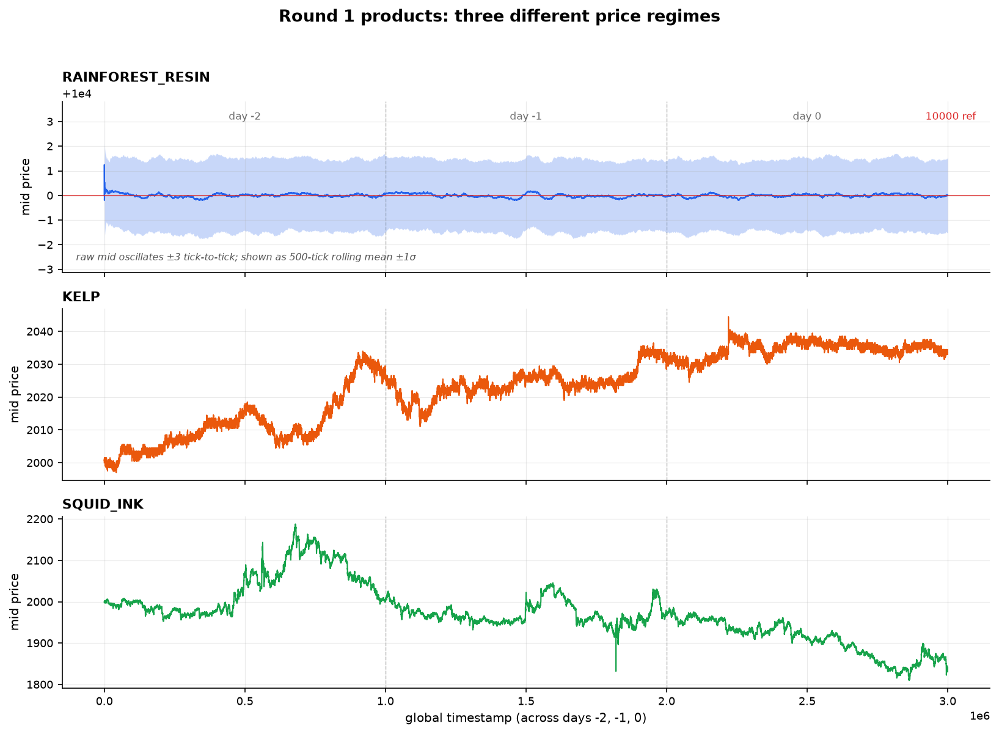

# Round 1 — Market making three different products

**Products:** `RAINFOREST_RESIN`, `KELP`, `SQUID_INK`

Round 1 is a pure market-making round. There is no arbitrage relationship to exploit and no
external signal: you get an order book per product, per timestamp, and you make money by
quoting both sides and capturing the spread without getting run over.

The three products look superficially similar and behave nothing alike.



| Product | Behaviour | What that implies |
| --- | --- | --- |
| `RAINFOREST_RESIN` | Never leaves [9996.5, 10003.5] across all three days, oscillating every tick | Fair value is effectively a constant. Quote wide, collect the spread, never chase |
| `KELP` | Slow, continuous drift with short-horizon reversion | Fair value must be *estimated* each tick, and the estimate must be robust to fake quotes |
| `SQUID_INK` | Violent, high-amplitude swings | Edge per trade is dwarfed by inventory risk. The right answer is to trade it *small* |

## The shared engine: take → clear → make

Almost every strategy in this repo runs the same three-phase pipeline each tick, against a
per-product `fair_value`. This is the single most reusable idea in the codebase.

1. **Take** — if someone is resting an order through our fair value by more than `take_width`,
   lift it. This is the only phase that pays the spread, and it is the only phase that makes
   money immediately.
2. **Clear** — if we are left holding inventory, try to flatten it at `fair ± clear_width`
   against liquidity that already exists. Inventory is a directional bet we never wanted.
3. **Make** — post passive two-sided quotes around fair value. `disregard_edge` decides which
   resting orders are too close to fair to be worth respecting, `join_edge` decides when to
   join a price level rather than penny it, and `default_edge` is the fallback width when the
   book gives us nothing to anchor to.

```python
# phase 1 — only cross the spread when the book is mispriced beyond take_width
if best_ask <= fair_value - take_width:
    quantity = min(best_ask_amount, position_limit - position)
    orders.append(Order(product, best_ask, quantity))
```

### Adverse selection filter

A naive mid-price `(best_bid + best_ask) / 2` is trivially manipulable: a single one-lot quote
far from the market drags your fair value with it. So for `KELP` and `SQUID_INK` the mid is
built only from levels with real size behind them (`prevent_adverse` / `adverse_volume`), on the
assumption that those are the market maker's quotes and everything thinner is noise or bait.

```python
# only levels with size >= adverse_volume are trusted to define fair value
mm_ask = [p for p in order_depth.sell_orders if abs(order_depth.sell_orders[p]) >= adverse_volume]
mm_bid = [p for p in order_depth.buy_orders  if abs(order_depth.buy_orders[p])  >= adverse_volume]
```

### One-step mean reversion

On top of the filtered mid, `KELP` and `SQUID_INK` apply a one-step AR(1)-style correction: if
the filtered mid just jumped, assume part of that jump gives back.

```python
ret  = (mid - last_mid) / last_mid
fair = mid * (1 + ret * reversion_beta)      # KELP: -0.229, SQUID_INK: -0.25
```

A negative `reversion_beta` means "fade the last move". The two betas were fit separately, and
the sign is the whole claim: these products revert at a one-tick horizon rather than trend.

## Per-product parameters as submitted

| Parameter | `RAINFOREST_RESIN` | `KELP` | `SQUID_INK` |
| --- | --- | --- | --- |
| fair value | MA(400) of mid, seeded at 10,000 | filtered mid + reversion | filtered mid + reversion |
| `take_width` | 1 | 1 | 2 |
| `clear_width` | 0 | 0 | 1 |
| `disregard_edge` | 1 | 1 | 2 |
| `join_edge` | 2 | 0 | 0 |
| `default_edge` | 4 | 1 | 0.5 |
| `adverse_volume` | — | 20 | 15 |
| `reversion_beta` | — | −0.229 | −0.25 |
| `soft_position_limit` | 30 | — | — |
| `stop_loss_threshold` | 50 | 25 | — |
| `iceberg_peak` | — | — | 8 |
| **self-imposed position cap** | **20** | **20** | **4** |

Three parameter choices carry most of the weight:

- **Resin quotes wide (`default_edge = 4`) and takes narrow (`take_width = 1`).** When fair value
  is a known constant, there is no reason to compete for queue position — just sit far out and
  get paid by anyone who needs immediacy. With the mid confined to a seven-tick band all week, a
  four-tick edge is enormous relative to the product's actual volatility, and it still fills:
  resin is the most profitable round-1 product by a factor of two
  ([results](../results/backtests.md)).
- **Squid ink is capped at 4 units.** Not 50, not 20. The product's swings are large enough that
  position size, not spread capture, dominates PnL. Capping the position is a cheaper way to
  control that risk than trying to forecast the swings.
- **Squid ink orders are sliced to 8 visible units** (`iceberg_peak`), so our true intent is
  never readable off the book.

```python
def iceberg(qty, peak):
    # never show more than `peak` units; sign-preserving
    return int(math.copysign(min(abs(qty), peak), qty))
```

### Stop losses

Resin and kelp both carry a hard circuit breaker that pre-empts the normal pipeline: if we are
long and the best bid falls more than `stop_loss_threshold` below fair value (50 for resin,
25 for kelp), the whole position is dumped at market. This exists because the MA-based fair
value is slow — if the product genuinely re-prices, the market maker is the last to find out,
and the stop is what stops a quoting bot from averaging into a trend.

## Parameter fitting

`research/grid_search/sweep_kelp.py` tunes kelp by brute force: it token-substitutes parameters
into a trader template, runs the backtester, and scrapes the final `profit_and_loss`.

- `prevent_adverse ∈ {True, False}` × `adverse_volume ∈ {10,15,…,40}` × `reversion_beta ∈ {0.10,0.15,…,0.40}`
- 98 combinations, one backtest each, ranked by total PnL

```bash
python research/grid_search/sweep_kelp.py          # writes output.txt + the combo list
python research/grid_search/rank_sweep_results.py  # ranks blocks in output.txt by total profit
```

One caveat worth stating plainly: the sweep script records each combination into
`kelp_sweep_combos.json` but never writes the PnL field into it, so the JSON is a list of what
was tried, not a ranking. The profit numbers only ever existed in the captured stdout, which is
what `rank_sweep_results.py` parses. The shipped `reversion_beta = -0.229` came from that log.

## Files

| Path | What it is |
| --- | --- |
| [`strategies/round1_resin_market_maker.py`](../strategies/round1_resin_market_maker.py) | Resin-only maker with iceberg replenishment |
| [`strategies/round1_resin_moving_average.py`](../strategies/round1_resin_moving_average.py) | Resin-only maker with MA fair value + stop loss |
| [`strategies/round1_squid_ink_reversion.py`](../strategies/round1_squid_ink_reversion.py) | Squid ink standalone, filtered mid + reversion |
| [`strategies/round1_squid_ink_simple.py`](../strategies/round1_squid_ink_simple.py) | Squid ink with a single positive-beta reversion term |
| [`research/notebooks/price_explorer.ipynb`](../research/notebooks/price_explorer.ipynb) | Stitches the three days into one time axis and plots a product |

All three products are also traded by the final [`trader.py`](../trader.py), which is what
actually ran in later rounds.

---

[← Overview](../README.md) · [Round 2 → Basket arbitrage](round-2.md)
