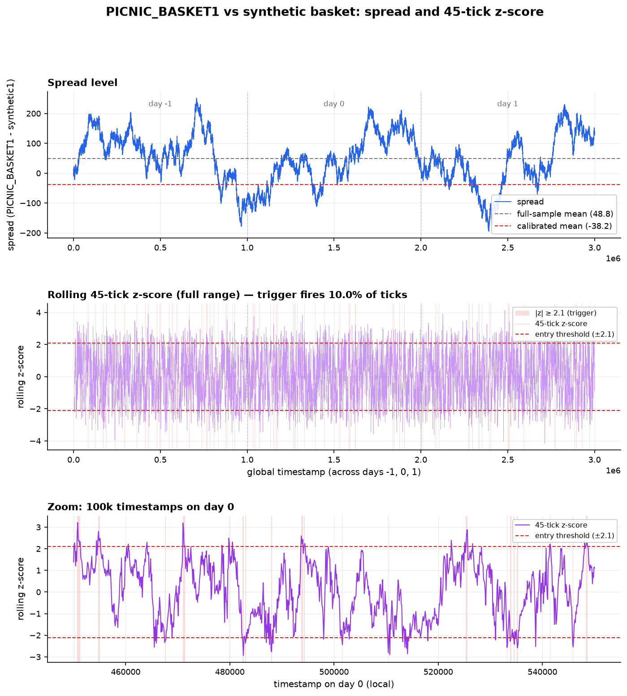

# Round 2 — Basket arbitrage

**Products added:** `CROISSANTS`, `JAMS`, `DJEMBES`, `PICNIC_BASKET1`, `PICNIC_BASKET2`

Round 2 introduces two composite products whose contents are published:

```
PICNIC_BASKET1 = 6 × CROISSANTS + 3 × JAMS + 1 × DJEMBES
PICNIC_BASKET2 = 4 × CROISSANTS + 2 × JAMS
```

That makes the baskets redundant securities. A basket can be replicated exactly from its
constituents, so there are two prices for the same cash flow — the traded basket, and the
**synthetic basket** you can build in the component books. The strategy is to trade the
difference and let it revert.

## Building the synthetic book

The synthetic basket needs a bid and an ask, not just a price, because we have to actually
execute both legs. Each side is the weight-weighted sum of the constituents' best prices, and
the available size is the *tightest* constraint across the legs — buying one synthetic basket 1
requires six croissants, so six croissants is one unit of synthetic.

```python
for asset, weight in constituents.items():
    bid_total += best_bid[asset] * weight
    ask_total += best_ask[asset] * weight
    bid_volumes.append(abs(order_depth.buy_orders[best_bid[asset]]) // weight)
synthetic_bid_volume = min(bid_volumes)   # the binding leg sets the size
```

Both the basket and the synthetic are then summarised by a **size-weighted mid** rather than a
plain mid, which matters in thin books where one side has far more size than the other:

```python
def get_swmid(order_depth):
    return (best_bid * best_ask_vol + best_ask * best_bid_vol) / (best_bid_vol + best_ask_vol)
```

## The signal

```
spread  = basket_swmid − synthetic_swmid
z       = (spread − default_spread_mean) / rolling_std(spread, 45)
```



The important subtlety is `default_spread_mean`. The spread does **not** oscillate around zero —
the baskets trade at a persistent premium or discount to their contents, so z-scoring against
zero would leave the strategy permanently short one basket and permanently long the other. The
mean is therefore a calibrated constant, fit offline from the historical data in
[`research/model_basket_spread.py`](../research/model_basket_spread.py), while only the
*standard deviation* is estimated from a rolling 45-tick window.

Entry is a pure threshold rule, with no separate exit band:

- `z ≥ +threshold` → spread is rich → target **short** basket / long synthetic, at `−target_position`
- `z ≤ −threshold` → spread is cheap → target **long** basket / short synthetic, at `+target_position`
- otherwise → hold the current target

Because the target is recomputed every tick, the position unwinds naturally as the z-score
crosses back through the band rather than via an explicit take-profit.

At ±2.1 the rule fires on **10.0%** of ticks over the round-2 data — frequent enough to stay
engaged with the spread, rare enough that the strategy is not simply always-on.

## Parameters as submitted

| Parameter | `PICNIC_BASKET1` | `PICNIC_BASKET2` |
| --- | --- | --- |
| `default_spread_mean` | −38.2 | 76.0 |
| `spread_std_window` | 45 | 45 |
| `zscore_threshold` | 2.1 | 2.1 |
| `target_position` | 60 | 100 |
| position limit | 60 | 100 |
| constituent limits | `CROISSANTS` 250 · `JAMS` 350 · `DJEMBES` 60 | |

The two baskets get opposite-signed means, which is the single most informative number here:
the shipped constants say basket 1 trades at a **discount** to its contents and basket 2 at a
**premium**.

That constant is also the strategy's weak point, and the figure above shows why. Over the
round-2 data the basket-1 spread averages about **+49**, not −38.2 — the calibrated mean sits a
full 87 points below the sample it is being z-scored against, which biases the bot toward buying
the basket. The value was re-fit repeatedly as the competition went on (`+43.0` in an earlier
version, `−38.2` in the submission, `50.0` in a round-5 variant), and
[`strategies/basket_params.json`](../strategies/basket_params.json) preserves an even earlier
configuration with both means at zero and a 2.0/2.5 threshold pair. A premium that moves that
much between rounds is not a constant, and treating it as one is the honest limitation of this
approach: the right version estimates the mean on a long rolling window and the standard
deviation on a short one, rather than freezing the level and re-fitting it by hand each week.

## Execution and hedging

`execute_spread_orders` trades the basket at its best bid/ask and the synthetic at the matching
side, sized to `min(basket_depth, synthetic_depth, |target − current|)` — never more than either
book can absorb. `convert_synthetic_basket_orders` then translates the synthetic leg into real
orders on `JAMS` and `DJEMBES`.

**It deliberately skips `CROISSANTS`:**

```python
component_orders = {asset: [] for asset in constituents.keys() if asset != Product.CROISSANTS}
...
if asset == Product.CROISSANTS:
    continue
```

So the shipped bot hedges the basket with only part of its replicating portfolio and carries the
croissant exposure outright. The evolution is visible in the logs: the round-2 version
[`strategies/round2_basket_arbitrage.py`](../strategies/round2_basket_arbitrage.py) *did* trade
croissants as a hedge leg and lost **−9,057** on them in that round's backtest, against
**+23,214** on basket 1. They were cut from the leg set afterwards, and in the final trader
`CROISSANTS` PnL is exactly **0** — the product is never touched.

That trade-off did not go away, it moved. Over round 5 the two baskets earn **+63,772** between
them while the surviving hedge legs give back **−35,934** (`JAMS` −45,822, `DJEMBES` +9,888), so
the basket complex nets about **+27,838** — more than half the gross consumed by the replication,
and roughly half of basket 1's weight now carried unhedged. This is the honest status of the
"arbitrage": it is a hedged directional position whose hedge is both incomplete and expensive.
Full numbers in [`results/backtests.md`](../results/backtests.md).

The constituents are never quoted on their own. They exist in the strategy purely as hedge legs.

## Files

| Path | What it is |
| --- | --- |
| [`strategies/round2_basket_arbitrage.py`](../strategies/round2_basket_arbitrage.py) | Both baskets + the round-1 products in one trader — the round-2 submission |
| [`strategies/round2_basket_arbitrage_single.py`](../strategies/round2_basket_arbitrage_single.py) | Basket 1 only, implied bid/ask computed inline, `zscore_threshold = 7` |
| [`strategies/round2_position_control.py`](../strategies/round2_position_control.py) | Generic multi-basket skeleton with untuned (zero) spread means |
| [`research/model_basket_spread.py`](../research/model_basket_spread.py) | Offline fit of the spread mean per day — where −38.2 and 76.0 come from |
| [`research/analyze_spread.py`](../research/analyze_spread.py) | Spread diagnostics |
| [`research/grid_search/sweep_baskets.py`](../research/grid_search/sweep_baskets.py) | 8-parameter sweep over both baskets' z-thresholds, windows and targets |

```bash
python research/model_basket_spread.py              # re-fit the spread mean from data/round2
python research/grid_search/sweep_baskets.py        # sweep thresholds/windows/targets
```

---

[← Round 1](round-1.md) · [Round 3 → Options on volcanic rock](round-3.md)
