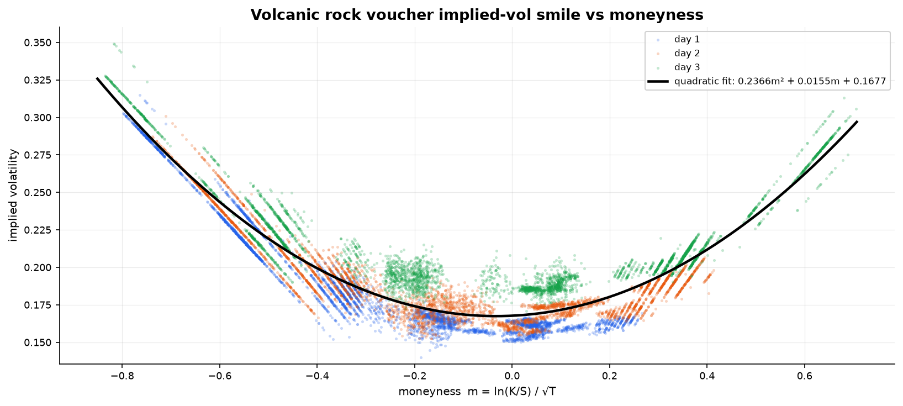

# Round 3 — Options on volcanic rock

**Products added:** `VOLCANIC_ROCK` and five European call vouchers struck at
9,500 / 9,750 / 10,000 / 10,250 / 10,500

Each `VOLCANIC_ROCK_VOUCHER_X` is a European call on `VOLCANIC_ROCK` with strike `X` and a
seven-round life. That turns the round into a derivatives problem: the vouchers are not
independent assets with their own fair values, they are functions of one underlying, and the
only free parameter is volatility.

So the question stops being "is this voucher cheap?" and becomes **"is this voucher's implied
volatility cheap relative to where that voucher's own implied volatility has been?"**

## Pricing

Standard Black-Scholes for a European call, zero rate:

```python
d1 = (log(spot) - log(strike) + 0.5 * vol**2 * T) / (vol * sqrt(T))
d2 = d1 - vol * sqrt(T)
call = spot * N(d1) - strike * N(d2)
delta = N(d1)
```

Implied volatility is recovered by inverting that numerically — bisection over `[0.01, 1.0]`,
200 iterations, tolerance `1e-10`. It is not elegant, but it is monotone, allocation-free and
cannot diverge, which matters when it runs five times per tick inside a time-limited callback.

It does have one failure mode worth knowing about. Reconstructing the surface offline, **8.9% of
solves had to be discarded**: deep in-the-money vouchers whose mid price sits at or below
intrinsic value, where no volatility reproduces the quote and the search simply pins to its lower
bound. The live bot has no such filter — it takes whatever the bisection returns, so those ticks
feed a near-zero IV into the z-score history. Clamping on the bound should be treated as "no
observation", not as an observation of zero vol.

Time to expiry counts rounds down and annualises on a 250-day convention:

```python
expiration = 7
remaining_rounds = max(expiration - (current_round - 1), 0)
tte = remaining_rounds / 250
```

## The volatility smile

Plotting implied vol against moneyness confirms the usual shape — the vouchers do not share one
volatility, they sit on a curve:



Here moneyness is normalised for time, `m = log(K/S) / √T`, which is the parameterisation that
makes the smile stable across days as expiry approaches. Fit a parabola across all three days and
you get

```
IV(m) = 0.2366·m² + 0.0155·m + 0.1677        base IV at the money ≈ 16.8%
```

a clean, almost symmetric smile — and a useful check on the code, since the `mean_volatility`
constants sitting unused in `PARAMS` (0.14 and 0.15) are about two vol points below where the
surface actually sits. The classic play in this round is to fit exactly that parabola each tick,
treat the fitted value as the voucher's fair vol, and trade the residual.

**The submitted bot does not do that.** Instead each voucher keeps its own 30-tick history of
implied vol and z-scores against itself:

```python
past_vol.append(volatility)                       # window = std_window = 30
vol_z = (volatility - mean(past_vol)) / std(past_vol)
if vol_z >= threshold:   target = -LIMIT          # IV spiked → voucher rich → sell it
elif vol_z <= -threshold: target = +LIMIT         # IV crushed → voucher cheap → buy it
```

The trade-off is real. A per-strike z-score needs no cross-sectional model and cannot be broken
by one bad strike, but it also cannot see relative value *between* strikes — if the whole surface
shifts up, every voucher looks rich at once. The smile fit is strictly more informative and
strictly more fragile; we shipped the robust version.

## Parameters as submitted

| Voucher | Strike | `zscore_threshold` | `std_window` | Position limit |
| --- | --- | --- | --- | --- |
| `VOUCHER_9500` | 9,500 | 1.0 | 30 | **0 — disabled** |
| `VOUCHER_9750` | 9,750 | 0.4 | 30 | 200 |
| `VOUCHER_10000` | 10,000 | 0.4 | 30 | 200 |
| `VOUCHER_10250` | 10,250 | 1.2 | 30 | **0 — disabled** |
| `VOUCHER_10500` | 10,500 | 2.0 | 30 | 200 |
| `VOLCANIC_ROCK` | — | — | — | 100 (self-imposed) |

Two decisions stand out:

- **The thresholds scale with distance from the money.** The two near-the-money strikes fire at
  z = 0.4, i.e. almost any deviation; the far wing at 10,500 needs z = 2.0. Wing IV is noisier
  and the options are cheaper in absolute terms, so the same z-score is worth less edge there.
- **Two strikes ship with a position limit of zero.** `9500` and `10250` are fully configured but
  cannot trade. Setting the limit to 0 rather than deleting the config is a deliberate kill
  switch — the strikes stayed in the pricing loop (and so kept contributing deltas) while being
  removed from risk. Which strikes were disabled changed between versions as the week went on;
  the two near-the-money strikes were the ones we kept conviction in throughout.

## Delta hedging

A voucher position is a position in the underlying whether you hedge it or not. Every tick, the
bot recomputes each voucher's Black-Scholes delta, sums the exposure, and trades
`VOLCANIC_ROCK` toward the offsetting position:

```python
target_rock_position = -delta * voucher_position_after_trade
```

This is what makes the strategy a volatility trade rather than a leveraged directional bet. It
is also where most of the residual risk lives: the hedge is recomputed from the current mid each
tick, so it is correct only to first order and only for as long as the mid is clean.

## Trading the underlying directly

`VOLCANIC_ROCK` also carries two independent overlays that run alongside the hedge:

- **Stop loss** — track an entry price; flatten if a long is 5% underwater (`mid < entry × 0.95`)
  or a short is 5% offside (`mid > entry × 1.05`).
- **Mean reversion** — a 15-tick simple moving average; if the mid is more than 2% away from it
  and we are flat, open a 10-lot against the deviation; flatten when it flips back.

Both emit orders into the same list as the hedge, so on any given tick the rock position is the
net of "what the options require" and "what the reversion signal wants". That coupling is the
least clean part of the design — see
[what we'd change next](../README.md#what-wed-change-next) in the overview.

## Files

| Path | What it is |
| --- | --- |
| [`strategies/round3_voucher_vol_trading.py`](../strategies/round3_voucher_vol_trading.py) | Vouchers + rock standalone — the first working version |
| [`strategies/round3_voucher_vol_delta_hedged.py`](../strategies/round3_voucher_vol_delta_hedged.py) | Adds the delta hedge and merges in rounds 1–2; direct predecessor of `trader.py` |
| [`research/plot_volcanic_rock.py`](../research/plot_volcanic_rock.py) | Rock mid-price and bid/ask spread over time |

```bash
python research/plot_volcanic_rock.py data/round4/prices_round_4_day_1.csv
```

Note that this repo has no `data/round3/` directory — the round-3 data bottle was not kept, but
`data/round4/` contains all five vouchers and the rock, so every voucher analysis here runs off
the round-4 files.

---

[← Round 2](round-2.md) · [Round 4 → Macarons and conversions](round-4.md)
