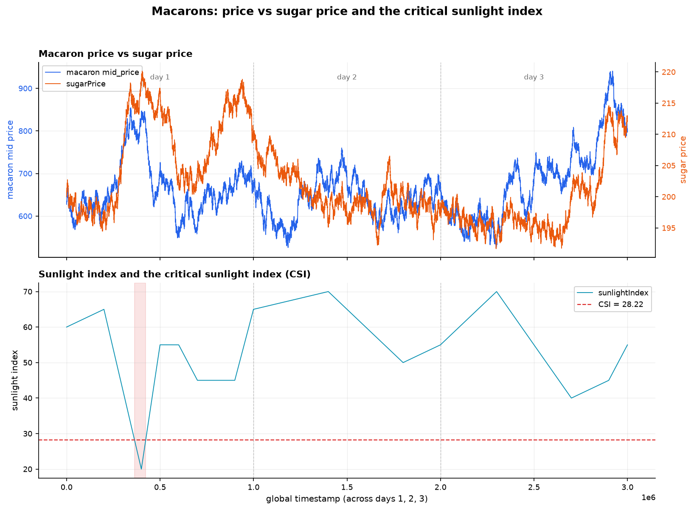

# Round 4 — Macarons, conversions and the critical sunlight index

**Product added:** `MAGNIFICENT_MACARONS`

Round 4 is the first round where the order book is not the primary source of information. Every
tick the exchange hands over a `ConversionObservation` for macarons:

```python
ConversionObservation(
    bidPrice, askPrice,        # price at the off-exchange conversion facility
    transportFees,             # cost to move a unit
    exportTariff, importTariff,
    sugarPrice,                # input cost
    sunlightIndex,             # growing conditions
)
```

That is a production story, not a price series: macarons are made from sugar, under sunlight,
and shipped with fees. So the fair value can be built bottom-up from costs rather than inferred
from quotes — and there is a second venue to arbitrage against.

## Fair value from cost of production

```python
fair = sugar_price * fair_value_multiplier     # multiplier = 1.0
fair += transport_fees + import_tariff
if sunlight_index < CSI:                       # CSI = 28.22
    fair *= 1.10                               # scarcity premium
fair -= position * storage_cost                # storage_cost = 0.1 per unit held
```

Three things are going on in those four lines:

1. **Sugar is passed straight through.** With the multiplier at 1.0, one unit of sugar price is
   one unit of macaron value, plus the landed cost of getting it there.
2. **Below a critical sunlight level, macarons get a 10% premium.** Bad growing conditions mean
   less supply, and the market prices that convexly rather than linearly.
3. **Inventory is charged rent.** Subtracting `position × storage_cost` from fair value is a neat
   trick: it does not just account for the carry, it *skews the quotes*. The longer we get, the
   lower our fair value, so our bid walks down and our ask walks down with it, and the book
   itself pushes inventory back toward flat.

## Finding the critical sunlight index

`CSI = 28.22` is not a guess and not a round number — it is fit.
[`research/find_critical_sunlight_index.py`](../research/find_critical_sunlight_index.py) sweeps
candidate thresholds across the percentiles of `sunlightIndex`, splits the price history into
below/above regimes at each candidate, and picks the threshold that maximises the gap between the
two regimes' mean mid-price. It is a one-dimensional regime-split search — crude next to a proper
changepoint model, but it produces a single defensible number from three days of observations.



```bash
python research/find_critical_sunlight_index.py    # re-derives the CSI from data/round4
```

The effect size is large and the direction is unambiguous:

| Regime | Ticks | Mean macaron mid |
| --- | --- | --- |
| `sunlightIndex < 28.22` | 600 | **810.42** |
| `sunlightIndex ≥ 28.22` | 29,400 | 660.64 |

Macarons trade about **23% richer** below the critical index — which is both why the premium was
set at 10% and a hint that 10% was too timid.

The figure is also the honest caveat. Those 600 ticks are **one** excursion: across all three
days the sunlight index drops below 28.22 exactly once, early on day 1, and the macaron price
spikes to its local high right there. The sunlight series is a slow, near-deterministic
piecewise-linear ramp, nothing like the noisy price series it is supposed to drive. So the whole
premium is calibrated on a single episode, which also coincides with a sugar spike — the
co-movement is clean and the threshold may still be measuring the wrong cause.

## Conversion arbitrage

The conversion facility is a second market with its own bid, ask and fee structure. After
quoting on the exchange, the bot checks whether converting is better than trading:

```python
buy_cost   = obs.askPrice + obs.transportFees + obs.importTariff
sell_value = obs.bidPrice - (obs.transportFees + obs.exportTariff)

if fair > buy_cost and position < LIMIT:
    conv_qty = +min(conversion_limit, LIMIT - position)   # import: cheaper to make than to buy
elif fair < sell_value and position > 0:
    conv_qty = -min(conversion_limit, position)           # export: sell into the facility
conversions = abs(conv_qty)
```

Both tests are strictly fee-inclusive, which is the whole point — the gross spread between the
two venues is frequently positive while the net is not, and the tariffs are what decide it. The
facility is capped at `conversion_limit = 10` units per tick, so this is a slow, steady drip
rather than a single large arb.

## Parameters as submitted

| Parameter | Value | Why |
| --- | --- | --- |
| `fair_value_multiplier` | 1.0 | Sugar passed through one-for-one |
| `CSI` | 28.22 | Fit by regime-split search |
| scarcity premium | ×1.10 below CSI | Convex supply response |
| `storage_cost` | 0.1 / unit / tick | Charges inventory, and skews quotes toward flat |
| `take_width` | 5.0 | Wide — the cost model is a slow signal, not a tick-level one |
| `clear_width` | 2.0 | |
| `disregard_edge` / `join_edge` / `default_edge` | 0.0 | Quote at fair; the skew comes from storage cost |
| `conversion_limit` | 10 / tick | Exchange rule |
| position limit | 75 | Exchange rule |

The `take_width = 5.0` is the notable one. Every other product in this repo takes at a width of
1–2. A cost-derived fair value updates on fundamentals, not on order flow, so it is routinely a
few ticks stale — demanding five ticks of edge before crossing the spread is the price of
trusting a slow model.

## How it actually did

Macarons lose money: **−12,985** across the three days of round-5 data. The split is instructive —
**−13,489** on day 3 and **+1,858** on day 4, so the product's entire positive contribution comes
from a single day.

They were also the one product we A/B-tested back to back during the competition: two runs twenty
minutes apart on the same data, identical in every other product, differing only in the macaron
block, scoring 0.0 and −13,489. The variant that shipped was the one that stayed flat.

On this evidence the cost model is sound and the conversion arbitrage is the part that pays — a
fee-inclusive comparison against a second venue is about as close to riskless edge as this
competition offers. What loses is the quoting layer wrapped around it: a `take_width` of 5.0 on a
fair value that moves with sugar rather than with flow means we cross the spread rarely and badly,
and the 10% CSI premium is a large, discontinuous jump applied to a threshold fit on one event.
Shipping the conversion arbitrage alone, with no quoting at all, would very likely have scored
better.

## Files

| Path | What it is |
| --- | --- |
| [`trader.py`](../trader.py) | The only trader with macaron logic — `MAGNIFICENT_MACARONS` block |
| [`research/find_critical_sunlight_index.py`](../research/find_critical_sunlight_index.py) | Fits the CSI threshold |
| `data/round4/observations_round_4_day_*.csv` | Sugar price, sunlight index, tariffs, facility quotes |

---

[← Round 3](round-3.md) · [Round 5 → Named counterparties](round-5.md)
