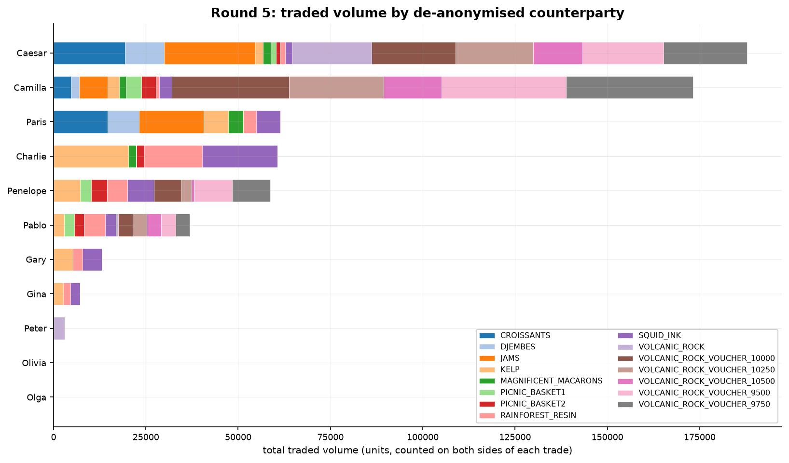

# Round 5 — De-anonymised counterparties

**Products added:** none. **Information added:** every trade in the history now names its buyer
and seller.

For four rounds the trade history is anonymous. In round 5 the counterparty field is populated
with real bot names — Caesar, Camilla, Charlie, Gary, Gina, Olga, Olivia, Pablo, Paris,
Penelope, Peter — for both the market trades and our own fills. Nothing about the market changes.
What changes is that flow becomes attributable.

That reframes the problem. Up to here, every signal in this repo is a function of price. Round 5
offers a different kind of signal: *who* is on the other side. If a counterparty's fills
systematically precede price moves, trading against them is expensive and trading alongside them
is informative.



Two things fall straight out of that chart, before any modelling:

- **Counterparties specialise.** Caesar and Camilla dominate the voucher and basket-constituent
  flow; Charlie and Gary trade almost nothing but kelp, resin and squid ink. The bots are not
  interchangeable liquidity — knowing who is quoting tells you something about which product you
  are about to be filled in.
- **Volume is wildly unequal, and the quiet names are the interesting ones.** Eleven names trade
  at all. Caesar (187,851 units) and Camilla (173,138) are about 60% of all flow between them,
  while Olivia trades 198 units and Olga 9 — across three entire days. A bot that trades that
  rarely and that selectively is exactly the profile that would make an identity signal valuable,
  and exactly the profile that three days of data cannot give you enough samples to confirm.

## The analysis pipeline

```bash
# 1. split every trade into per-counterparty files (a trade counts for both sides)
python research/split_trades_by_counterparty.py data/round5/trades_round_5_day_*.csv --outdir by_name

# 2. who is even in this market?
python research/list_counterparties.py

# 3. behavioural fingerprint per counterparty
python research/counterparty_features.py

# 4. volume over time, per counterparty, per product
python research/plot_counterparty_volume.py by_name/Gary.csv
```

[`research/counterparty_features.py`](../research/counterparty_features.py) is the one that
matters: for each counterparty it computes trade-size statistics and, critically, the **average
deviation of their trade price from the prevailing mid**. That single number separates the
population into two groups — counterparties who consistently pay away from mid (they want
immediacy; they are a revenue source) and counterparties who consistently trade *through* mid in
the direction the market subsequently moves (they are informed; they are a cost).

## What we built with it

Two pieces of live counterparty logic exist in this repo. Both are honest about their status:
neither is in the final submission.

### 1. Counterparty-aware resin maker

[`strategies/round5_counterparty_aware_resin.py`](../strategies/round5_counterparty_aware_resin.py)
singles out one counterparty — Gary — and does two things with him:

```python
if cp_user != "Gary":
    continue
stats["pnl"] += -tr.quantity * (tr.price - fv)    # running PnL from trading against Gary
...
if pnl > 0:
    mm_bid = int(fv - de + 1)                      # we're winning: quote tighter, get more of it
    mm_ask = int(fv + de - 1)
```

- **Adaptive spread.** Track our running PnL from every fill against Gary. If it is positive,
  tighten the resin quotes by a tick to attract more of that flow. This is the cleanest idea in
  the round: let realised PnL, per counterparty, decide how aggressively we compete for their
  orders.
- **Flow mirroring.** When Gary appears in the public market trades, place an order on the same
  side at his price, up to remaining capacity — piggy-backing on a counterparty treated as
  informed.

### 2. Counterparty flow throttle on volcanic rock

[`strategies/all_rounds_alt_trader.py`](../strategies/all_rounds_alt_trader.py) takes the
opposite, defensive angle, and does it without naming anyone:

```python
ROCK_FLOW_THRESHOLD = 200
ROCK_WIDTH_FACTOR   = 0.5
ROCK_LIMIT_BOOST    = 1.5
...
if any(flow >= ROCK_FLOW_THRESHOLD for flow in rock_flow_by_cp.values()):
    take_w  *= ROCK_WIDTH_FACTOR      # halve the widths
    clear_w *= ROCK_WIDTH_FACTOR
    def_e   *= ROCK_WIDTH_FACTOR
```

It aggregates per-tick volume by counterparty and, if any single counterparty pushes 200+ units
through us in one tick, switches into a tighter-quoting, higher-capacity mode. The reasoning is
that a counterparty doing size that fast is doing it for a reason, and the right response to a
large one-sided flow is to reprice around it rather than keep quoting as if nothing happened.

## What actually shipped

The final [`trader.py`](../trader.py) contains **zero** references to any counterparty name and
no counterparty-conditional branches — verifiably so:

```bash
grep -icE "gary|caesar|camilla|charlie|gina|olga|olivia|pablo|paris|penelope|peter" trader.py   # 0
```

The submitted bot traded round 5 on price signals alone: moving-average and reversion fair values,
basket spread z-scores, and voucher implied-vol z-scores. The counterparty work stayed research.

That is the honest headline of this round, and it is worth stating rather than hiding. Round 5
handed us the one piece of information no amount of price modelling can recover, and we got as far
as fingerprinting the population and prototyping two ways to use it, but not as far as trusting
either in production. A single-name rule fit on three days of data is a thin basis for live
quoting, and with the deadline in front of us the conservative call was to ship the
price-only bot. The flow-throttle idea — defensive, nameless, and therefore much harder to
overfit — is the one we would promote first given another run at it.

For what the price-only bot did score, see [`results/backtests.md`](../results/backtests.md): the
full round-5 window reproduces at **+789,066**, with the best single day at +310,761.

## Files

| Path | What it is |
| --- | --- |
| [`research/split_trades_by_counterparty.py`](../research/split_trades_by_counterparty.py) | Fans the trade history out into one CSV per name, counting both sides |
| [`research/list_counterparties.py`](../research/list_counterparties.py) | Unique buyer/seller names |
| [`research/counterparty_features.py`](../research/counterparty_features.py) | Size stats and average deviation from mid, per counterparty |
| [`research/plot_counterparty_volume.py`](../research/plot_counterparty_volume.py) | Daily volume per counterparty, overall and by product |
| [`strategies/round5_counterparty_aware_resin.py`](../strategies/round5_counterparty_aware_resin.py) | Gary-adaptive resin maker (prototype) |
| [`strategies/all_rounds_alt_trader.py`](../strategies/all_rounds_alt_trader.py) | Full alternative trader with the rock flow throttle |

---

[← Round 4](round-4.md) · [Overview →](../README.md)
